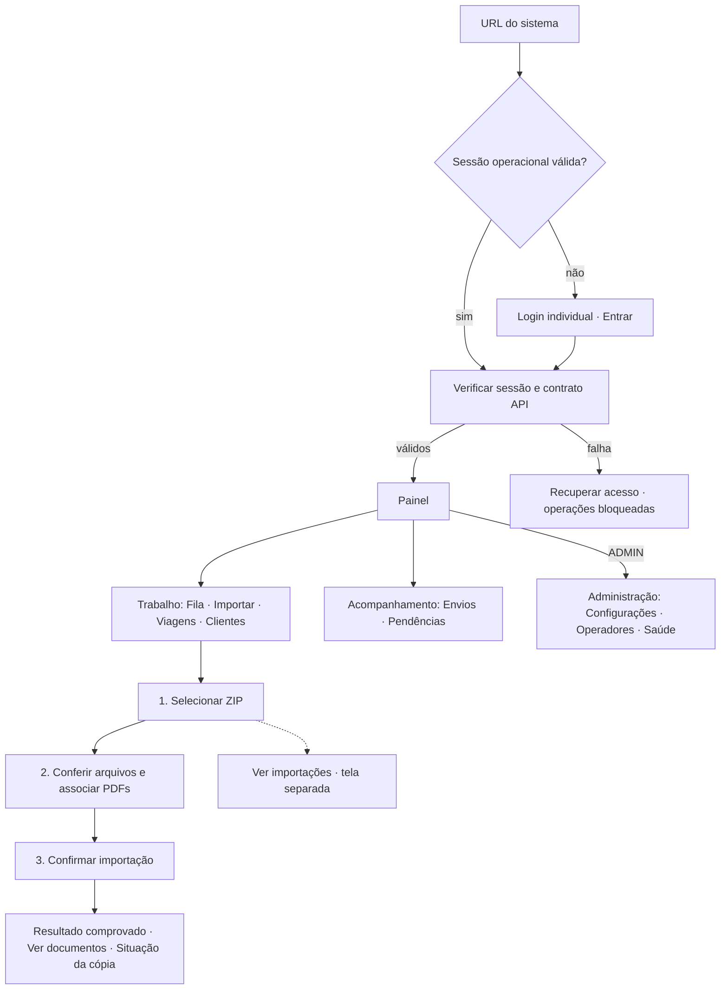

# Uso diário simplificado — 03/11/2026

**Revisão operacional de 09/11/2026:** [resultados atuais](revisao-operacional-20261109.md),
com comparação Git/bootstrap, ZIP funcional em H2 isolado, correção do resumo
documental, regra comercial ao cliente, preparação central e testes de backup V14.
Os resultados abaixo conservam suas execuções históricas e não são somados aos atuais.

## Complemento: erros do ZIP e títulos da fila — 09/11/2026

Preservando a simplificação e as revisões locais abaixo:

- ZIP inválido mostra uma lista compacta com **arquivo, problema e próxima ação**.
  O diagnóstico técnico permanece recolhido em **Ver detalhes**. A mensagem genérica
  da recusa não duplica a lista, e trocar o arquivo limpa os problemas anteriores.
- Na fila, **Assumir** recebe destaque antes da ação secundária de recuperação.
  Referências usadas pelo backend como nome são apresentadas como **Tentativa de
  envio**, **Confirmação de recebimento**, **Cópia dos documentos** ou **Processamento
  de arquivo**. Origem e UUID continuam em **Histórico e referências**; o contrato de
  responsabilidade e seu controle de versão são preservados.

Verificação deste complemento: build limpo externo com 387 testes contabilizados
(386 aprovados, 1 ignorado, zero falhas/erros); roteiros de uso diário (12 grupos),
uso compartilhado (10), arquivos/páginas (10), exclusão de cliente (5) e zoom real
100/150/200% aprovados. Após o ajuste final dos títulos da fila, o roteiro de uso
diário foi repetido com asserções de ausência de UUID nos títulos e preservação da
referência nos detalhes. Não houve erros JavaScript não tratados. Os testes novos
também verificam a orientação visível dos arquivos inválidos com diagnóstico fechado.

Capturas finais das 12 abas em 1366×768, 1920×1080 e 390×844, além das etapas de
seleção, associação e erros de XML/PDF do ZIP. Os artefatos deste complemento estão
fora do checkout, em `C:/Users/florb/AppData/Local/Temp/opencode/`:

- `rotabrasil-simplificacao-20261108-build/`: JAR e relatórios JUnit.
- `rotabrasil-simplificacao-20261108-junit.log`: saída do build completo aprovado.
- `rotabrasil-simplificacao-20261108-ui-entrega/`: `resultado.json` e capturas finais.
- `rotabrasil-simplificacao-20261108-multi/`: concorrência e permissões.
- `rotabrasil-simplificacao-20261108-arquivos/`: integridade e navegação.
- `rotabrasil-simplificacao-20261108-clientes/`: conferência/exclusão.
- `rotabrasil-simplificacao-20261108-zoom/`: medições e capturas de zoom real.

Somente bases H2 V14 e arquivos sintéticos isolados, sem envio externo. Permanecem
as limitações de homologação da conta real e de auditoria de acessibilidade descritas
abaixo. Não houve acesso ou migração do banco operacional.

## Revalidação integrada — 09/11/2026

O checkout já continha a simplificação descrita na revisão de 07/11. Após conferir
`git status`, AGENTS, README, contratos ZIP/Configurações, módulos e rotas reais,
as alterações locais foram preservadas e complementadas:

- **ZIP:** voltar à seleção foca o arquivo sem retirá-lo da ordem de tabulação.
  Tab e Shift+Tab continuam utilizáveis; Retomar mantém as associações válidas.
- **Configurações:** ação bem-sucedida remove o diagnóstico transitório anterior,
  mantendo seus registros no histórico. Estado da conta também usa ícone e texto.
- **Envios:** histórico compacto com data, CT-e, destinatário e resultado. UUID,
  anexos e referência do reenvio ficam em **Ver detalhes**. Falha/resultado desconhecido
  mantêm motivo e orientação visíveis; processamento sem conclusão não recebe verde.
- **Pendências:** orientação geral recolhida em **Como usar**. Atualizar histórico
  e Atualizar fila têm destaque de ação principal.

### Execução desta revisão

Somente H2 sintético V14, arquivos sintéticos e diretórios externos; nenhuma alteração
de banco operacional, credenciais ou documentos reais. SMTP real desativado nas
execuções de navegador. Nenhuma mensagem externa enviada ou backup executado.

| Verificação executada | Resultado |
|---|---|
| `mvn -B -Drotabrasil.build.directory=... clean test` | 387 contabilizados, 386 aprovados, zero falhas/erros, 1 ignorado por symlink no Windows |
| `mvn -B -Drotabrasil.build.directory=... -DskipTests package` | JAR empacotado com os estáticos atuais |
| `testar-uso-diario.cjs` | 12 grupos; inclui teclado ao voltar no ZIP, recuperação do diagnóstico de Configurações e UUID recolhido no histórico |
| `testar-uso-compartilhado.cjs` | 10 grupos; dois operadores, versões, rascunho, busca, permissões, CSRF e sessão |
| `testar-exclusoes-paginas.cjs` | 10 grupos; XML/PDF/ZIP, fatura compartilhada, SHA-256, revisão, arquivamento/restauração, filtros e navegação |
| `testar-exclusao-cliente.cjs` | 5 grupos; impacto, cancelamento, conferência vencida e preservação de documentos compartilhados |
| `testar-zoom-uso-diario.cjs` | Zoom real 100%, 150%, 200%; larguras CSS 1350, 900 e 675, sem overflow nas telas verificadas |
| `git diff --check` | Sem erros de whitespace |

Todos os roteiros de navegador concluídos registraram zero erros JavaScript não
tratados. A primeira execução do build foi interrompida pelo limite de 200 segundos
da ferramenta; a execução limpa completa seguinte passou. No ensaio novo de falha
da verificação de pasta, HTTP 503 em POST foi corretamente tratado como resultado
incerto (âmbar); a expectativa do roteiro foi corrigida para preservar essa regra.
A repetição explícita com resposta comprovada removeu o diagnóstico transitório.

Capturas das 12 abas em **1366×768**, **1920×1080** e **390×844**, além de
associações ZIP, operação autenticada e zoom real. Amostra de Configurações com
texto de 15 px e contraste mínimo 7,06:1 claro / 9,36:1 escuro. Teclado/foco,
diálogos e menu aberto/recolhido/móvel exercitados pelos roteiros; isso não é
auditoria completa de acessibilidade ou de leitores de tela.

Artefatos externos em `C:/Users/florb/AppData/Local/Temp/opencode/`:

- `rotabrasil-revisao-20261108-build/`: JAR e relatórios JUnit desta execução.
- `rotabrasil-revisao-20261109-ui/`: `resultado.json` e capturas das 12 abas,
  incluindo `zip-associacoes-1366.png`, `configuracoes-1366.png`, `pacotes-390.png`
  e `email-1920.png`.
- `rotabrasil-revisao-20261109-multi/`: concorrência, autorização e capturas móveis.
- `rotabrasil-revisao-20261109-arquivos/`: integridade, filtros, navegação e menu.
- `rotabrasil-revisao-20261109-clientes/`: conferência/exclusão de cliente.
- `rotabrasil-revisao-20261109-zoom/`: medições e capturas do zoom real.

As limitações operacionais ao fim deste documento permanecem: envio real depende
da configuração/autorização externa e homologação. O resultado sintético não é
diagnóstico de um pacote operacional específico. O diagrama atualizado mantém
os links existentes e explicita os detalhes do histórico de envios.

## Revisão de todas as abas — 07/11/2026

Esta revisão complementa as alterações locais anteriores, preservadas após `git status`.
Foram confirmadas as **12 telas existentes**, além de Importações anteriores. O frontend
continua em HTML/CSS e módulos JavaScript do mesmo Spring Boot, sem novas dependências.
Cada rota recebe título claro e uma frase curta da sua função no cabeçalho.

### Onde estão as ferramentas

| Tela | Superfície principal | Sob demanda |
|---|---|---|
| Visão geral | Indicadores, pendências, atalhos para importar e continuar na fila; até cinco viagens | Consultas completas nas abas correspondentes |
| Importar ZIP | Selecionar → Conferir → Importar; resumo de viagens, PDFs e associações pendentes | Diagnóstico em Ver detalhes; importações anteriores em tela própria; confirmação ao motorista opcional |
| Importar XML ou PDF | Seleção, limite curto e ação correspondente | Viagem/CT-e aparecem somente para PDF; finalidade e vínculos na conferência ZIP |
| Viagens e documentos | Busca, cliente e lista paginada | Datas/situação em Mais filtros; documentos só após selecionar viagem; Voltar à lista preserva busca/filtros/página |
| Clientes | Nome/CNPJ, contato quando informado, detalhes e viagens | Exclusão nos detalhes, seguida da conferência de impacto existente |
| Central de envios | Seleção explícita, destinatário e conferência; Envio não configurado no modo sem envio real | Históricos recolhidos; testes mantêm identificação Teste sem envio |
| Processamentos e pendências | Problema, pacote, situação, data e ações de recuperação | Etapa, causa, impacto, orientação, problemas e referências em Ver detalhes |
| Configurações | Conta/estado, pasta autorizada, cópia automática, Salvar alterações | Criar subpasta, autenticação, testes e histórico recolhidos |
| Operadores | Busca, situação, nome/papel/estado e Adicionar operador | Cadastro e permissões em diálogos; redefinição de acesso e suas consequências no formulário específico; auditoria recolhida |
| Fila compartilhada | Meus itens/sem responsável/todos, situação, responsável e ação | Mais filtros; histórico, referências e transferência administrativa recolhidos |
| Busca integrada | Pesquisa principal, tipo de resultado e resultados paginados | Mais filtros; referências internas nos detalhes, sem IDs nos títulos dos resultados |
| Saúde do sistema | Cartões com condição informada pelo backend | Orientações, evidências e referências em Ver detalhes; Como interpretar e ações administrativas recolhidos |

Conta salva não significa conta autenticada; configuração de pasta não significa cópia
comprovada. Saúde mantém os estados **Disponível, Requer atenção, Indisponível, Não
configurado e Não verificado**, conforme o resultado existente. Consultas não iniciam
envio externo, backup ou varredura documental. O menu mantém Trabalho, Acompanhamento
e Administração; entradas administrativas continuam restritas.

### Correções funcionais desta revisão

- Uma falha na consulta de tentativas de e-mail podia rejeitar o `Promise.all` da
  consulta documental e impedir a exibição de XMLs/PDFs disponíveis. As consultas
  documentais agora são independentes dos históricos, com erro contextual no histórico.
- Uma reconferência ZIP com erro de transporte podia manter linhas da conferência
  anterior na tela. A resposta inconclusiva agora limpa essa apresentação e bloqueia
  avanço. As escolhas válidas persistidas para os mesmos bytes voltam após nova
  conferência bem-sucedida. O teste injeta 503 e comprova o rascunho recuperado.
- Resultados da importação individual passam a ter feedback local, evitando repetir
  o mesmo resultado no aviso global. IDs deixam de compor a mensagem principal.
- Detalhes de clientes são descartados ao fechar; cancelamento da exclusão devolve
  foco à ação da lista, preservando os dados. Concorrência e confirmação de impacto
  continuam no backend.

### Evidências da revisão

Somente bases H2 sintéticas V14, diretórios externos e transporte sem envio.
Nenhum banco operacional, documento real ou credencial foi utilizado. Não há migração nova.

| Verificação | Resultado |
|---|---|
| Build limpo externo `mvn -B -Drotabrasil.build.directory=... clean test` | 387 testes, 386 aprovados, zero falhas/erros, 1 ignorado (symlink Windows) |
| `testar-uso-diario.cjs` | 12 grupos: importação, associação, falhas, rascunho, exportação/retomada, envio honesto, documentos independentes do histórico, layouts, HTTPS/papéis/CSRF/sessão |
| `testar-uso-compartilhado.cjs` | 10 grupos, incluindo cadastro em diálogo e conflito de versão nas permissões, além de configuração, fila e busca |
| `testar-exclusoes-paginas.cjs` | 10 grupos, com XML, PDF avulso, ZIP/fatura compartilhada, revisão, arquivamento/restauração, integridade, navegação e menu responsivo |
| `testar-exclusao-cliente.cjs` | 5 grupos: impacto, cancelamento, conferência vencida 409, exclusão confirmada e preservação de fatura compartilhada |
| `testar-zoom-uso-diario.cjs` | Zoom real 100%, 150% e 200%; larguras CSS 1350/900/675, sem overflow nas telas verificadas |

Capturas das **12 abas** em 1366×768, 1920×1080 e 390×844. Regressão adicional
de arquivos/menu em 360–1440 px. Verificação de foco por teclado e diálogos; amostra
de Configurações em 15 px com contraste mínimo 7,06:1 (claro) e 9,36:1 (escuro).
Isso não constitui auditoria completa de acessibilidade ou de todos os leitores de tela.

Artefatos externos em `C:/Users/florb/AppData/Local/Temp/opencode/`:

- `rotabrasil-simplificacao-20261107-build/`: JAR e relatórios JUnit.
- `rotabrasil-simplificacao-20261107-ui/`: resultados, capturas das abas e log sintético.
- `rotabrasil-simplificacao-20261107-multi/`: concorrência/permissões e capturas móveis.
- `rotabrasil-simplificacao-20261107-arquivos/`: integridade e navegação.
- `rotabrasil-simplificacao-20261107-clientes/`: exclusão confirmada e resultados.
- `rotabrasil-simplificacao-20261107-zoom/`: medições e capturas do zoom real.

As primeiras repetições simultâneas de quatro suítes tiveram timeouts de navegador;
a validação final foi sequencial. A captura adicional da página de login em HTTPS
também apresentou timeout do Chrome e foi retirada do roteiro de capturas: todas as
asserções de autenticação, cookies, papéis e CSRF foram mantidas e executadas.
Capturas operacionais autenticadas continuam disponíveis. O atalho de zoom em
headless não altera o zoom real nesta máquina; por isso há um roteiro separado com
perfil temporário e medição de largura/DPR. Scripts históricos não executados nesta
revisão não são apresentados como aprovados.

Limitações operacionais continuam as descritas ao fim deste documento: envio real
depende de autorização/configuração externa e homologação; o pacote real não foi
diagnosticado por inferência. Nenhum SMTP real foi habilitado ou acionado.

---

## Base e investigação

HEAD examinado: `5dcc23765bc54b66fbe79b04b24fc6454eadcfa4`. Foram preservadas as
alterações locais anteriores em `index.html`, `painel-importacao.js`,
`painel-pacotes.js`, `testar-exclusoes-paginas.cjs` e `pacotes-assistidos.md`.
O esquema continua **V14**. Nenhuma migração foi necessária.

### O que foi comprovado sobre o ZIP

Na execução inicial com JAR atualizado e base isolada V14, inspeção e confirmação
de um ZIP sintético retornaram **200**. A inspeção não gravou documentos; a
confirmação com associações explícitas gravou XML/PDF. Portanto, não foi constatada
uma recusa geral do importador no backend. O pacote real relatado não foi utilizado
nem diagnosticado por inferência.

Foi reproduzido um bloqueio no frontend: responder **503 a `painel-saude.js`**
impedia a resolução dos imports estáticos de `painel.js`. Nesse cenário, nenhuma
requisição de versão, sessão, inspeção ou confirmação era feita. O botão de
importação permanecia inacessível na página não inicializada. A mensagem de erro
do carregamento não aparecia como erro contextual utilizável. Além disso, o código
aguardava sequencialmente Administração, Fila, Busca, Saúde e Configurações antes
de configurar a importação e liberar o painel.

Falhas HTTP 503 nas **APIs** de responsáveis/configurações, isoladamente, já eram
tratadas pelos módulos; não foram apresentadas como causa de uma falha que não
reproduziram. O problema de dependência de carregamento do JavaScript foi reproduzido
separadamente. A necessidade de associar PDFs também era um bloqueio válido, mas
ficava misturada ao diagnóstico e não equivalia a erro de transporte/importação.

Evidência inicial externa: `.../opencode/reproducao-zip-20261103.json`.
No log da base sintética inicial, a referência
`f2f5e3b0-e723-4a06-abc8-f5a003ed89a2` corresponde ao POST de inspeção 200.
Os testes atuais registram status HTTP e `X-Request-Id` em `resultado.json`,
com o log sintético correlacionável em `servidor.log`.

## Inicialização e entrada

- Compatibilidade da API e sessão continuam pré-requisitos essenciais. Falha
  nesses requisitos bloqueia alterações, mesmo se o usuário abrir o diagnóstico.
- Eventos de importação são configurados antes das consultas independentes.
  Administração, Fila, Busca, Saúde, Configurações e Importações são inicializadas
  ao abrir a tela. O histórico de pendências carrega independentemente para o contador.
- Falha de carregamento de módulo secundário apresenta tentativa local. Se o módulo
  não carregar porque a sessão expirou, a sessão é reconsultada e a recuperação global
  de acesso aparece. O frontend não trata redirecionamento ao login como sucesso do módulo.
- Não existe espera mínima de cinco segundos nem animação obrigatória de saída.
  A abertura só acompanha a verificação necessária; consultas posteriores têm estados locais.
- Em `operacao`, acessar o painel sem sessão leva ao formulário público `/login`,
  com botão **Entrar**. Uma sessão válida acessando `/login` vai diretamente ao painel.
  Não foi acrescentada uma landing page intermediária.
- Em `desenvolvimento`, `/login` explica o acesso local sem conta individual e oferece
  **Abrir painel local**. Esse perfil continua restrito a loopback/dados isolados.
- BCrypt, CSRF, revalidação de papéis/sessão, cookies e controles de autorização
  do backend foram preservados. Não existe cadastro público nem senha padrão nova.

## Importar documentos

1. **Selecionar:** arrastar/escolher ZIP, ver nome/tamanho e clicar em **Conferir
   arquivos**. Uma linha informa limites e a opção secundária XML/PDF individual.
2. **Conferir:** resumo de viagens/PDFs, XMLs reconhecidos, finalidade e vínculos
   explícitos de cada PDF, prévia/revisão existente. O botão informa, por exemplo,
   **Associe os 2 PDFs pendentes para continuar.** Arquivos com problemas são destacados;
   detalhes de arquivos válidos ficam recolhidos.
3. **Importar:** resumo da seleção e **Confirmar importação**. Só a resposta de
   confirmação permite apresentar sucesso, acesso aos documentos e situação da cópia.

Voltar preserva as escolhas válidas. **Retomar conferência** retorna à conferência
da mesma seleção. Trocar o arquivo invalida a conferência; rascunhos existentes
continuam limitados ao SHA-256 correspondente e revalidados pelo backend. Após o
resultado, é possível rever a conferência ou iniciar outro ZIP. Uma inspeção apta
nunca é apresentada como importação concluída. Não há porcentagem fictícia.

**Ver importações** abre `/#pacotes-importados` em tela própria. O hash permanece
válido; deixou de representar uma seção no rodapé do formulário. `#documentos`
continua levando a Viagens; foram mantidas/adicionadas rotas amigáveis equivalentes
`#importar`, `#envios`, `#pendencias`, `#operadores`. Voltar/avançar usa o histórico
nativo do navegador.

Confirmação ao motorista está separada e recolhida, acessível também pelo histórico.
É opcional e não exige informar e-mail para importar. Não se deduz destinatário do
ZIP, do cliente ou do CT-e. Sem transporte real configurado, sua ação de envio fica
indisponível. Eventos e tentativas anteriores permanecem consultáveis.

## Configurações e envios

A superfície de Configurações contém conta/endereço e estado resumido, pasta
autorizada no computador do backend, seleção/criação permitida de subpasta,
**Verificar pasta**, cópia automática e salvamento com indicação de alterações.
Versão de edição é enviada ao servidor, mas não ocupa o resumo visual. HTTP 409
preserva o rascunho e exige recarga/revisão explícita.

Autenticação/requisitos da conta, ferramentas de teste e histórico ficam em seções
recolhidas administrativas. Verificação sem envio é rotulada como tal e não promete
autenticação, conectividade SMTP ou entrega. Testes reais existentes continuam em
seção administrativa própria, com suas exigências e confirmação; nenhum foi executado.

No fluxo cotidiano, modo sem transporte real mostra **Envio não configurado** e
não permite gerar/confirmar uma tentativa que apenas simularia o envio. Os contratos
backend de teste foram preservados. Históricos distinguem **Teste sem envio**, aceite
do provedor (sem comprovar entrega/leitura), falha e resultado desconhecido.
Estados persistidos não foram renomeados nem apagados.

## Navegação e apresentação

O menu agrupa **Trabalho**, **Acompanhamento** e **Administração**. Fila, Importar
documentos, Viagens e Clientes são entradas do trabalho; XML/PDF individual e busca
continuam acessíveis. Envios e Pendências ficam no acompanhamento. Configurações,
Operadores e Saúde aparecem no grupo administrativo somente para ADMIN; atalhos
também respeitam essa apresentação. Resumos de saúde continuam autorizados pelo
contrato backend existente, inclusive por link direto quando permitido.

Texto operacional usa 15 px; detalhes e informações auxiliares têm tamanho legível.
Identidade e temas foram preservados. Decoração/slogans de abertura e hero foram
reduzidos; formulários têm largura limitada e tabelas continuam aproveitando a tela.
Diagnósticos compartilham o componente existente, com referências e explicações
extensas em **Ver detalhes**. Alertas da página anterior não acompanham a navegação;
carregamentos de históricos ocultos não anunciam cada erro como aviso global.

Veja o [diagrama de navegação](diagramas/navegacao-uso-diario.mmd).



## Regras preservadas

Transação integral, associação explícita, fatura compartilhada, SHA-256, leitura
segura, limites de ZIP, prevenção de sobrescrita, arquivamento/restauração,
histórico/auditoria, concorrência/idempotência, fila/responsáveis e exportação externa
permanecem nos serviços existentes. Resultado desconhecido exige consulta/revisão;
não há repetição automática. Retomada da cópia não reimporta documentos nem envia e-mail.
Nenhuma alteração fiscal ou correção de destinatário é inferida automaticamente.

## Validação atual

Somente H2 isolado e arquivos sintéticos. Builds, bases de teste, logs e capturas
ficam fora do checkout e do `target` histórico. A base operacional não foi aberta,
migrada ou alterada; não houve mensagem externa nem ativação de SMTP real.

| Execução | Resultado |
|---|---|
| JUnit completo | 387 contabilizados, 386 aprovados, zero falhas/erros, 1 ignorado (symlink no Windows) |
| `testar-uso-diario.cjs` | 11 grupos de verificações; ZIP completo, falhas secundárias/essenciais, inválidos/correção, resposta perdida/idempotência, exportação/retomada, configuração/histórico sem envio e perfil operacional HTTPS com três papéis |
| `testar-uso-compartilhado.cjs` | 9 verificações; cadastro, conflitos preservando rascunho, dois operadores, fila/responsáveis, busca, saúde, logout e sessão expirada |
| `testar-exclusoes-paginas.cjs` | 10 verificações; XML/ZIP/PDF avulso, fatura compartilhada, prévia/revisão, arquivamento/restauração, hashes e navegação/layout |
| `testar-zoom-uso-diario.cjs` | Zoom real do Chrome em 100%, 150% e 200%; Importar, Configurações e Fila sem overflow |

Nenhum erro JavaScript não tratado nas execuções aprovadas. Falhas HTTP e perda de
resposta são injetadas deliberadamente nos cenários correspondentes; não são
tratadas como envios/importações concluídos pelo navegador.

Capturas em 1366×768, 1920×1080 e 390×844; regressão adicional em 360–1440 px.
Na medição de zoom real, largura CSS caiu de **1350 → 900 → 675**, com DPR
**1 → 1,5 → 2**, sem CSS zoom/transform. O primeiro ensaio via atalho em contexto
headless não alterou o zoom; por isso a validação final usa a preferência real do
Chrome em perfil temporário, nunca o perfil do usuário.

Medição automatizada de uma amostra de controles/textos principais de Configurações:
15 px e contraste mínimo **7,06:1 no claro** e **9,36:1 no escuro**. A amostra não
equivale a uma certificação de acessibilidade de todos os componentes. Teclado/foco,
diálogos e menu móvel foram exercitados; capturas incluem zoom ampliado.

Artefatos sob `C:/Users/florb/AppData/Local/Temp/opencode/`:

- `rotabrasil-diario-build/`: JAR e relatórios JUnit.
- `rotabrasil-diario-ui/`: `resultado.json`, `servidor.log`, capturas ZIP,
  Configurações, Envios e operação autenticada.
- `rotabrasil-diario-multi-ui/`: resultados e capturas do uso compartilhado.
- `rotabrasil-diario-arquivos-ui/`: resultados e capturas de arquivos/navegação.
- `rotabrasil-diario-zoom-ui/`: resultados e capturas de zoom real.

Comandos reproduzíveis (substitua a saída por pasta temporária externa):

```sh
mvn -B -Drotabrasil.build.directory=CAMINHO_EXTERNO clean test
mvn -B -Drotabrasil.build.directory=CAMINHO_EXTERNO -DskipTests package
npm ci --prefix scripts
node scripts/testar-uso-diario.cjs CAMINHO_EXTERNO/rota-brasil-0.0.1-SNAPSHOT.jar SAIDA_EXTERNA
node scripts/testar-uso-compartilhado.cjs CAMINHO_EXTERNO/rota-brasil-0.0.1-SNAPSHOT.jar SAIDA_MULTI_EXTERNA
node scripts/testar-exclusoes-paginas.cjs CAMINHO_EXTERNO/rota-brasil-0.0.1-SNAPSHOT.jar SAIDA_ARQUIVOS_EXTERNA
node scripts/testar-zoom-uso-diario.cjs CAMINHO_EXTERNO/rota-brasil-0.0.1-SNAPSHOT.jar SAIDA_ZOOM_EXTERNA
```

Nesta máquina foi reutilizado o Playwright instalado na pasta temporária externa,
via `NODE_PATH`. O teste HTTPS usa `keytool` do JDK para certificado sintético
descartável e senha aleatória; não altera certificados ou credenciais operacionais.
O teste de zoom abre Chrome com perfil temporário próprio.

A instância local desta conversa foi reiniciada em `http://localhost:8080` com o
JAR validado de `rotabrasil-diario-build`, reutilizando somente sua base sintética
V14 anterior, com Flyway desligado. Inspeção visual de prontidão confirmou a tela
ZIP e Configurações disponíveis, sem erro JavaScript. Ela continua em
`desenvolvimento`, sem autenticação individual; o perfil operacional foi validado
separadamente no ambiente HTTPS descartável descrito acima.

## Limitações e preparação operacional

- O pacote real relatado continua sem diagnóstico específico; não foi solicitado
  nem usado documento real. As causas de interface acima foram reproduzidas com
  falhas controladas e corrigidas sem relaxar validações de conteúdo.
- Uso em PCs diferentes depende da implantação central com perfil `operacao`,
  contas individuais, HTTPS confiável, raiz externa e permissões da conta do backend.
- Cada banco precisa ter a versão verificada separadamente. Migração operacional
  continua condicionada a autorização específica e backup verificado.
- A conta de envio precisa de identificação, autorização/configuração externas e
  homologação. Endereço salvo e teste sem envio não comprovam sua disponibilidade.
- Os scripts históricos de envio simulado descrevem a interface anterior. Os
  contratos e testes backend dessas operações permanecem; a validação da superfície
  cotidiana atual é feita pelo roteiro novo, que exige envio indisponível quando
  o transporte real não está configurado.
