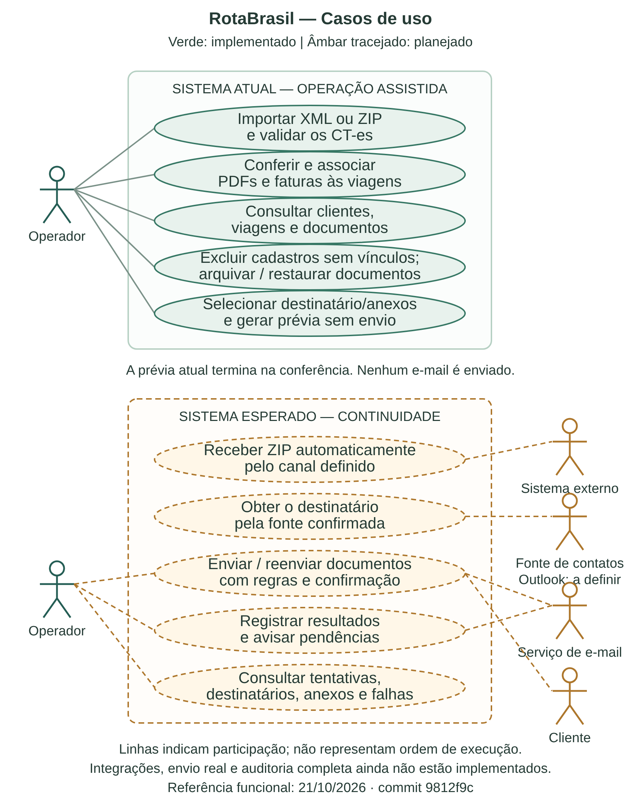

# RotaBrasil — Visão geral do sistema

**Situação atual, objetivos e próximos passos**  
**Data:** 21 de outubro de 2026  
**Referência do código funcional:** commit `9812f9c`, disponível nas branches `main` e `work`.

## 1. Apresentação

O RotaBrasil é um sistema em desenvolvimento para organizar documentos de viagens de caminhão e apoiar seu envio aos clientes. A proposta nasce de uma tarefa prática: outro sistema já produz os documentos da operação, mas ainda é necessário separar os arquivos, identificar a viagem correta, encontrar o destinatário e encaminhar os anexos por e-mail.

O objetivo é reduzir esse trabalho manual e os erros de associação, duplicação ou envio para a pessoa errada. O RotaBrasil recebe e conserva os documentos produzidos externamente; não emite CT-e, não gera documentos fiscais e não cria faturas ou boletos.

Hoje existe um **protótipo funcional com importação assistida**. Já é possível importar XMLs ou ZIPs, organizar viagens e clientes, relacionar PDFs e preparar uma prévia de e-mail. A automação completa, desde o recebimento do ZIP até o envio e acompanhamento das falhas, ainda está em desenvolvimento.

Este documento separa três situações: funcionalidades implementadas e verificadas; comportamentos esperados para a entrega; e decisões ainda pendentes de confirmação com quem utilizará o sistema.

## 2. Problema que queremos resolver

Na rotina informada, o sistema externo gera um pacote compactado com documentos XML e PDF. Esses documentos precisam ser organizados por viagem e encaminhados ao cliente. Uma fatura pode reunir várias viagens, o que torna insuficiente simplesmente colocar cada arquivo na primeira pasta encontrada.

Sem apoio do sistema, uma pessoa precisa abrir o ZIP, conferir seu conteúdo, descobrir a qual viagem cada documento pertence, separar a cobrança, localizar o e-mail e fazer o envio. Quando chega uma correção ou um arquivo repetido, também precisa evitar duplicações e preservar o histórico.

O resultado esperado é uma operação em que os documentos fiquem relacionados corretamente, o destinatário seja conhecido e o encaminhamento possa ser acompanhado. Quando houver dúvida, o sistema deve permitir conferência em vez de adivinhar o vínculo.

## 3. O que aprendemos com o levantamento

As respostas fornecidas sobre a operação orientam o desenvolvimento. Algumas informações já são claras; outras ainda precisam de detalhamento.

| Tema | Informação recebida e consequência para o sistema |
|---|---|
| Entrada dos documentos | O pacote é um ZIP com XMLs e PDFs produzidos externamente. A entrada por ZIP já foi implementada de forma assistida. |
| Quantidade de viagens | Um ZIP pode conter várias viagens. O sistema precisa examinar seu conteúdo, sem assumir um pacote por viagem. |
| Identificação | A viagem é identificada pelo número do CT-e, chamado nCT no XML. O novo fluxo ZIP recusa mais de um CT-e para a mesma viagem. |
| Cobrança | Uma fatura pode reunir várias viagens. Por isso, o mesmo PDF pode ter vários vínculos, sem duplicar o arquivo. |
| Boleto | Foi informado que não há boleto nesse fluxo. Não há emissão de boleto no escopo atual. |
| E-mail do cliente | Foi mencionado o Outlook. Ainda não está definido se o contato virá de cadastro, contatos, mensagem recebida ou outra fonte. |
| Momento do envio | A expectativa informada é enviar assim que o ZIP for recebido. A implementação atual aguarda conferência e não realiza envio. |
| Responsável | Foi indicado que qualquer pessoa da operação poderia autorizar ou acompanhar. Perfis, identificação dos usuários e permissões ainda precisam ser definidos. |
| Correções e repetição | Foi pedido permitir novo envio após confirmação. A confirmação e o histórico desse reenvio ainda precisam ser implementados. |
| Acompanhamento | Há interesse em consultar destinatário, anexos e falhas. Parte das falhas pode aparecer depois do envio inicial. |

Uma resposta inicial mencionava três arquivos, mas o levantamento posterior confirmou pacotes com várias viagens. Por isso, a implementação não exige uma quantidade fixa de XMLs ou PDFs.

Também será necessário confirmar se o destinatário fiscal identificado no XML é sempre o cliente que deve receber a documentação e a cobrança. O vínculo comercial não deve ser presumido apenas porque um nome aparece no CT-e.

## 4. O que temos implementado

### 4.1. Painel web

O sistema tem uma interface acessível pelo navegador, servida pela própria aplicação. Não é necessário iniciar um projeto separado de frontend.

O painel permite visualizar contagens de clientes, viagens e XMLs ativos; importar XML e ZIP; buscar viagens pelo número ou nome do cliente; consultar documentos; arquivar e restaurar arquivos logicamente; selecionar anexos e gerar uma prévia de e-mail.

A interface atual é um painel de apoio aos testes. A indicação de “testes” na tela não cria isolamento por conta própria: as ações usam o banco configurado no servidor. Por isso, demonstrações devem utilizar uma base separada com documentos sintéticos.

### 4.2. Clientes e viagens

A API permite cadastrar, consultar, atualizar e excluir clientes e viagens, respeitando as restrições de integridade. O painel oferece consulta e exclusão protegida; não há formulários completos de cadastro e edição dessas entidades na tela atual.

O cliente possui nome, CNPJ e contatos opcionais. A viagem possui número, cliente associado, data e status. Na importação XML, o sistema utiliza os dados estruturados disponíveis para identificar ou cadastrar o cliente e a viagem.

E-mail ou telefone ausentes no XML permanecem sem preenchimento. O sistema não inventa contatos. Alterações em dados que identificam cadastros já vinculados são protegidas para evitar que documentos antigos passem a apontar para outra identidade.

### 4.3. Importação individual de XML

A importação aceita CT-e 4.00 e lê o número da viagem, dados do destinatário e chave de acesso. São feitas verificações estruturais, de versão, número, modelo fiscal e dígito verificador da chave. Quando há protocolo no XML, sua chave precisa corresponder à do CT-e.

O sistema registra a chave e uma impressão digital do conteúdo, o SHA-256. Isso permite distinguir o mesmo documento recebido novamente de um arquivo diferente apresentado com a mesma chave.

Reimportar a mesma chave com os mesmos bytes reutiliza o registro. Um conteúdo diferente para a mesma chave é bloqueado para revisão. Essa conferência não equivale a validação completa de assinatura digital, XSD ou autorização pela SEFAZ.

### 4.4. Importação assistida de ZIP

O fluxo ZIP tem duas fases. Primeiro, **Conferir ZIP** lê o pacote, valida as entradas e apresenta os CT-es e PDFs encontrados, sem registrar a importação no banco ou publicar arquivos definitivos. Depois, a pessoa escolhe os vínculos e confirma a gravação.

Cada PDF precisa ser associado explicitamente. Um **documento de viagem** corresponde a uma única viagem. Uma **fatura** pode corresponder a uma ou mais viagens. O sistema não tenta deduzir essa relação pelo nome do arquivo, pela ordem no ZIP ou por uma quantidade esperada de documentos.

Ao confirmar, o servidor lê novamente o ZIP e confere se seu conteúdo corresponde ao pacote inspecionado. A importação grava os XMLs, PDFs e vínculos em uma transação. Se ocorrer uma falha, os novos registros e as publicações próprias são desfeitos, evitando uma importação parcialmente concluída.

O ZIP pode conter apenas XMLs, mas precisa de pelo menos um CT-e válido. No fluxo atual, um pacote contendo somente PDFs não fornece a identificação necessária para importar viagens.

### 4.5. Faturas compartilhadas

Uma fatura que reúna várias viagens é armazenada como um único PDF, associado às viagens selecionadas. Ela aparece na consulta de cada uma dessas viagens, sem que seja necessário copiar seu arquivo várias vezes.

Isso organiza o documento de cobrança, mas ainda não representa um módulo financeiro. Não há, nesta entrega, cadastro estruturado de valor da fatura, vencimento, baixa, pagamento ou conciliação bancária. Esses recursos dependeriam de uma ampliação de escopo.

### 4.6. Prévia de e-mail

O usuário escolhe uma viagem, marca os XMLs e PDFs ativos e informa o destinatário. O sistema apresenta os metadados selecionados para conferência e informa que nenhum e-mail foi enviado.

A prévia verifica se os documentos selecionados pertencem à viagem ou possuem vínculo com ela e se estão ativos. Ela não verifica a disponibilidade nem os bytes dos anexos no momento da consulta. Também não agenda um envio, não cria uma tentativa no histórico e não comprova entrega.

O envio operacional de e-mail continua desativado. Existe uma ferramenta separada para um teste manual de Gmail com XML sintético, mas o envio real desse teste não foi comprovado: credencial e conectividade continuam como pré-requisitos. Isso não habilita o envio dos documentos da operação.

### 4.7. Exclusão, arquivamento e restauração

Clientes só podem ser excluídos quando não possuem viagens ou histórico de envio. Viagens só podem ser excluídas quando não possuem documentos, PDFs vinculados ou histórico, inclusive documentos arquivados.

Documentos não são apagados fisicamente pela tela. A ação de excluir um documento funciona como **arquivamento**: preserva o registro, os bytes e seus vínculos, retirando-o da consulta ativa e da prévia. O filtro de arquivados permite restaurá-lo.

No caso de uma fatura compartilhada, arquivar ou restaurar o PDF afeta sua disponibilidade em todas as viagens vinculadas. O sistema não cria uma cópia independente por viagem.

### 4.8. Repetição e correções

O mesmo ZIP, com os mesmos bytes e as mesmas associações, reutiliza o pacote já importado. Alterar as associações de um ZIP já registrado é bloqueado para preservar a conferência anterior.

Um novo ZIP pode trazer um PDF corrigido. Sua confirmação cria novos registros e conserva os anteriores, que podem ser arquivados. Isso não dispara reenvio. PDFs idênticos presentes em ZIPs diferentes não possuem deduplicação global automática.

A regra de um CT-e por viagem é aplicada no novo fluxo ZIP. O endpoint individual de XML conserva o contrato anterior; dados legados que já tenham divergências precisam de revisão específica. Não se deve presumir que todo acervo histórico já cumpre a regra comercial nova.

### 4.9. Armazenamento, inventário e backup

Os arquivos novos recebem nomes controlados pelo servidor. Os caminhos recebidos dentro do ZIP não são usados para escrever livremente no sistema de arquivos. A publicação preserva destinos existentes e utiliza registros temporários de operação para lidar com falhas.

Existem rotinas de inventário, backup verificado e migração. O inventário considera documentos, PDFs, pacotes e tabelas de associação. A recuperação de operações interrompidas é conservadora e depende de registros confirmados; ela não adota arquivos órfãos automaticamente.

Essas ferramentas precisam ser executadas e incorporadas à rotina de operação. Sua existência não significa que backups periódicos, monitoramento ou recuperação de desastre já estejam automatizados em produção.

## 5. Exemplo de uso hoje

Considere um ZIP com dois XMLs, um PDF de comprovante e um PDF de fatura. Os números e arquivos deste exemplo são ilustrativos.

1. O operador seleciona o ZIP e solicita a conferência.
2. O sistema identifica as viagens A e B pelos respectivos CT-es.
3. O operador marca o comprovante como documento da viagem A.
4. O operador marca a fatura como documento das viagens A e B.
5. Após conferir, confirma a importação. Os documentos e seus vínculos são registrados juntos.
6. Ao consultar a viagem A, encontra seu XML, o comprovante e a fatura compartilhada.
7. Ao consultar a viagem B, encontra seu XML e a mesma fatura, sem uma segunda cópia física.
8. Seleciona os anexos desejados, informa o e-mail e gera a prévia.
9. A operação termina na conferência. O envio de verdade ainda não ocorre pelo sistema.

O ganho já disponível é a organização com vínculos explícitos e preservação dos arquivos. O ganho esperado na próxima entrega é concluir o encaminhamento e acompanhar seu resultado.

### 5.1. Diagrama de casos de uso

O diagrama apresenta os participantes e suas interações com o RotaBrasil. O
operador utiliza as funções internas; o sistema externo fornece os documentos;
a fonte de contatos poderá fornecer o destinatário; o serviço de e-mail fará o
transporte; e o cliente será o destinatário da documentação.

{width=15cm}

No quadro superior, as funções verdes já estão implementadas. No inferior, as
funções em âmbar tracejado representam o desenvolvimento esperado. As linhas
mostram participação, não uma sequência de execução. Um ator desenhado não
significa que exista uma integração ou um perfil de acesso implementado.

A origem exata do ZIP e o uso do Outlook como fonte de contatos ainda precisam
ser definidos. O envio futuro deverá considerar confirmação, auditoria,
tratamento de falhas e prevenção de repetição. A fonte editável do desenho está
em `docs/diagramas/casos-de-uso-rotabrasil.svg`.

## 6. O que esperamos entregar

O objetivo principal é chegar ao seguinte fluxo de trabalho:

**Receber o ZIP → identificar os CT-es → relacionar os documentos → organizar as viagens → determinar o destinatário → enviar os anexos → registrar a tentativa e acompanhar falhas.**

A expectativa de disparo assim que o ZIP chegar depende de regras confiáveis para associação e destinatário. Enquanto alguma informação estiver indefinida ou houver conflito, o sistema deverá apresentar uma pendência para conferência. O fluxo assistido atual permite continuar desenvolvendo e testar a organização sem esperar todas essas decisões.

| Capacidade esperada | Resultado desejado | Situação atual |
|---|---|---|
| Receber os documentos | Entrada pelo canal utilizado na rotina, sem a pessoa precisar repetir etapas desnecessárias. | Upload manual implementado; canal automático pendente. |
| Identificar viagens | Relacionar cada XML ao CT-e e ao cliente correto. | Implementado com as validações descritas; amostra operacional anonimizada ainda deve confirmar a adequação. |
| Associar PDFs e faturas | Separar documentos por viagem e permitir cobrança compartilhada. | Associação manual implementada; regras para associação automática ainda não definidas. |
| Localizar o destinatário | Usar um contato confiável e permitir conferência quando necessário. | Digitação na prévia disponível; integração com Outlook pendente de definição. |
| Enviar e-mail | Encaminhar os documentos selecionados ao destinatário autorizado. | Transporte operacional não implementado. |
| Registrar tentativas | Mostrar data, destinatário, anexos, resultado e motivo da falha. | Consulta de histórico existente disponível; auditoria completa das novas tentativas ainda pendente. |
| Tratar correções e reenvios | Preservar documentos anteriores e solicitar confirmação antes de reenviar. | Preservação e confirmação de importação disponíveis; reenvio operacional pendente. |
| Acompanhar falhas posteriores | Identificar problemas que ocorram depois da aceitação inicial do envio. | Mecanismo e canal de aviso ainda precisam ser definidos. |

O primeiro marco útil de entrega pode ser o **fluxo manual completo**, com importação, conferência e envio confirmado pelo operador. A automação do recebimento e do disparo pode vir depois, utilizando as regras validadas nesse fluxo. Essa é uma ordem proposta para reduzir dependências; não altera a expectativa final de automatização.

## 7. O que ainda precisamos decidir

### 7.1. Entrada do ZIP

É necessário confirmar se o arquivo chegará por pasta monitorada, caixa de e-mail, exportação de outro sistema ou outro canal. A simples existência de uma pasta chamada “entrada” no projeto não significa que haja um monitor automático funcionando.

### 7.2. Origem dos contatos

Precisamos entender o significado de “Outlook” nessa rotina: onde está o endereço e como ele será relacionado ao cliente. Também é preciso definir quem poderá corrigir esse contato e o que fazer se houver mais de um destinatário possível.

### 7.3. Relação entre XML, PDF e cobrança

Uma amostra anonimizada deve mostrar como o sistema externo nomeia e organiza os arquivos e como a operação identifica os PDFs de cada CT-e. Precisamos confirmar se uma fatura pode abranger viagens de clientes diferentes e, nesse caso, quem deve recebê-la. Nenhuma dessas regras pode ser concluída apenas pelo nome do PDF.

### 7.4. Envio e correção

Precisamos definir a conta remetente, autenticação, tamanho máximo dos anexos, assunto e corpo da mensagem. Também falta decidir se a unidade de envio será a viagem, a fatura ou um conjunto de viagens. Uma fatura compartilhada não deve provocar mensagens repetidas sem uma regra explícita.

Para correções, precisamos definir quando há uma nova versão, quem confirma o reenvio e como o histórico mostrará o motivo. Falhas com resultado desconhecido exigem cuidado: repetir uma tentativa sem conferir pode gerar mensagens duplicadas.

### 7.5. Operação e acesso

Antes de disponibilizar o sistema a vários usuários, será necessário definir identificação dos operadores, permissões e responsáveis por pendências. Autenticação e perfis de acesso não estão implementados nesta entrega. Não existe ainda prazo de retenção acordado para documentos e históricos.

## 8. Caminho proposto para concluir a entrega

Os blocos abaixo são uma proposta de continuidade, sem estimativa de prazo. Eles não substituem as etapas históricas do projeto e não significam que o sistema já esteja publicado para uso operacional.

| Ordem | Trabalho | Critério de conclusão |
|---|---|---|
| 1 | Validar o fluxo assistido com amostras anonimizadas e confirmar as regras comerciais. | Equipe identifica corretamente cada viagem, PDF, fatura e destinatário nos exemplos, incluindo correção e repetição. |
| 2 | Preparar o ambiente de uso e migrar o banco existente, quando autorizado. | Inventário e backup verificados, migrações até V6 aplicadas e dados anteriores preservados. |
| 3 | Implementar envio manual com auditoria e confirmação de reenvio. | Uma ação confirmada usa destinatário/anexos conferidos, registra sua tentativa e trata falhas sem sobrescrever o histórico. |
| 4 | Integrar a origem dos contatos e automatizar o recebimento do ZIP. | Canal definido funciona, não repete importações e apresenta pendências quando faltam dados ou há conflito. |
| 5 | Habilitar automação do disparo e acompanhamento operacional. | Regras comerciais aprovadas, prevenção de duplicidades, avisos de falha, responsáveis e rotina de backup/recuperação exercitados. |

A aceitação do e-mail pelo servidor de saída não comprova que o destinatário recebeu ou leu a mensagem. O histórico deverá distinguir a tentativa, a aceitação pelo servidor e eventuais falhas posteriores, de acordo com o mecanismo disponível.

## 9. Base técnica e organização dos dados

A aplicação utiliza Java 25, Maven, Spring Boot 3.5.6, Spring Web, Spring Data JPA, H2, Lombok e Flyway. A interface atual utiliza HTML, CSS e JavaScript, servidos pelo Spring Boot. O fluxo principal é organizado em controller, service, repository e banco.

| Informação | Papel no sistema |
|---|---|
| Cliente | Identifica o cadastro associado às viagens e guarda contatos quando conhecidos. |
| Viagem | Agrupa a operação identificada pelo número do CT-e. |
| Documento XML | Conserva o CT-e, a chave de acesso, o hash e seu vínculo com a viagem. |
| Pacote | Registra a identidade do ZIP e a configuração confirmada da importação. |
| Anexo PDF | Conserva o documento de viagem ou fatura e pode estar vinculado a várias viagens. |
| Histórico de envio | Possui consulta dos registros existentes; precisa evoluir para auditar os novos envios reais. |

Os arquivos são armazenados separadamente do banco, que conserva seus metadados e relacionamentos. Portanto, uma estratégia de backup precisa preservar os dois conjuntos de forma compatível.

A versão atual exige migrações até **V6**. A V5 acrescenta arquivamento de documentos e a V6 cria pacotes, anexos e vínculos. O banco operacional não recebeu essas migrações na implementação mais recente. Atualizar o código no Git não atualiza automaticamente o banco nem coloca a aplicação em produção.

Para demonstrações, deve ser utilizada uma base nova e isolada. A migração do banco existente exige autorização, escritores parados e backup atual verificado. Os procedimentos detalhados estão na documentação de manutenção do repositório.

## 10. Validações realizadas e limites

Na última validação da versão funcional, passaram **234 testes JUnit**, sem falhas, erros ou casos ignorados. Também passaram **25 verificações de navegador**: 17 do painel anterior e 8 do fluxo ZIP assistido.

Os cenários incluem importação, validação de contratos da API, duplicidade, concorrência, falhas de gravação e publicação, rollback, arquivamento, restauração, fatura compartilhada, prévia sem envio, reinicialização e backup com os novos vínculos. Os testes de navegador verificam também o uso em desktop e celular.

Os testes utilizam arquivos sintéticos e bancos isolados. Não representam homologação com os documentos reais da empresa, não comprovam entrega por Gmail/Outlook e não comprovam implantação em produção. Testes de reinicialização não são equivalentes a todos os cenários de queda abrupta de energia ou desastre.

A entrada ZIP possui limites de 20 MiB para o pacote, 100 entradas, 20 MiB por arquivo e 100 MiB descomprimidos, além de proteção contra caminhos inseguros, nomes ambíguos, conteúdo corrompido e taxas excessivas de compressão. PDFs exigem cabeçalho reconhecido, mas não passam por validação completa do formato nem antivírus.

## 11. Limites do escopo atual

Não estão implementados: emissão fiscal, geração de PDF ou cobrança, cálculo de frete, controle de pagamentos, rastreamento de caminhão, integração SEFAZ, leitura automática da caixa Outlook, recebimento automático do ZIP, associação automática de PDFs, envio operacional, auditoria completa de tentativas e autenticação de operadores.

Alguns desses itens, como envio e recebimento automático, fazem parte do objetivo de continuidade. Outros, como rastreamento e gestão financeira completa, só devem entrar mediante uma nova definição de escopo. Organizar uma fatura PDF não equivale a administrar seu pagamento.

## 12. Referências para continuidade

O código funcional de referência está no repositório **isaac-Francisco-de-araujo/projetoIntegrador07api**, commit `9812f9c`, nas branches `main` e `work`.

Para detalhamento, consulte no próprio repositório:

- `README.md`: apresentação e execução.
- `docs/pacotes-assistidos.md`: fluxo ZIP, associações, contratos e limites.
- `docs/exclusoes-arquivamento.md`: exclusões protegidas e restauração.
- `docs/etapa4-banco-migracoes.md`: inventário, backup e manutenção do banco.
- `docs/etapa3-armazenamento-seguro.md`: publicação de arquivos e recuperação.
- `docs/etapa6-contrato-api.md`: contratos e validações da API.
- `docs/etapa8-previa-email.md` e `docs/teste-gmail.md`: prévia e teste separado de e-mail.

A documentação histórica descreve a evolução por etapas. Quando houver diferença, os contratos do fluxo ZIP assistido e esta visão geral descrevem o estado mais recente aqui registrado. Novas funcionalidades e decisões de negócio devem atualizar este documento para que ele continue servindo como referência da entrega.
